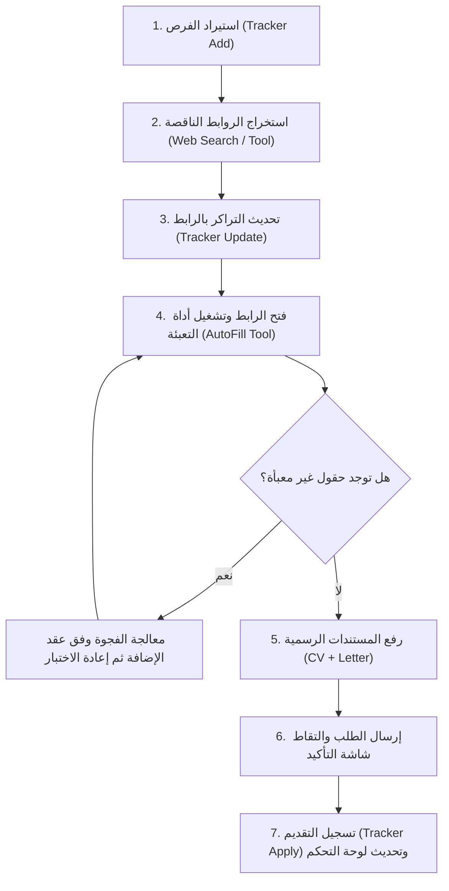

# 🤖 دليل بوت التقديم التلقائي الذكي (Autonomous Co-op Apply Playbook)

> **⚠️ مبادئ صارمة لا تقبل الاستثناء (Non-Negotiable Rules):**
> 1. **منع استخدام أي بيانات وهمية منعاً باتاً (Zero Mock Data):**
>    ممنوع نهائياً استخدام أي أسماء أو إيميلات أو هواتف تجريبية (مثل: Mohammed Abdullah أو example.com أو أرقام وهمية). يجب دائماً استخدام بيانات نجيب الموسوي الحقيقية فقط من [My CV.md](file:///c:/Users/xxnje/OneDrive%20-%20King%20Faisal%20University/الجامعة/coop%20training/My%20CV.md) و [data.js](file:///c:/Users/xxnje/OneDrive%20-%20King%20Faisal%20University/الجامعة/coop%20training/cv-autofill-extension/data.js).
> 2. **الأداة أولاً ودائماً (Tool-First Execution):**
>    يُحظر على الوكيل تعبئة الحقول عبر كتابة كود يدوي في الكونسول (`document.querySelector(...).value = ...`). وظيفة الوكيل تشغيل محرك الأداة ([cv-autofill-extension](file:///c:/Users/xxnje/OneDrive%20-%20King%20Faisal%20University/الجامعة/coop%20training/cv-autofill-extension))؛ وإذا وُجد حقل غير معروف، يتم تدريب الأداة عليه وتحديث قواعدها لتملأه بنفسها.
> 3. **إثبات التقديم الحقيقي (Proof of Submission):**
>    التجربة لا تُعد ناجحة إلا عند إرسال النموذج فعلياً والوصول إلى شاشة التأكيد النهائية الرسمية، والتقاط لقطة شاشة كإثبات.
> 4. **استخدام أدوات المشروع الرسمية للإدارة:**
>    جميع عمليات إضافة وتحديث وتوثيق الشركات تتم حصرياً عبر أداة التراكر الرسمية: `node data/tracker.js`.
> 5. **التحسن المستمر:** اتبع عقد الإضافة الفني المرتبط أدناه. اجمع الفجوة، أصلحها، اختبرها، ثم وثّق درسًا جديدًا دون تكرار.

---

## 📁 مسارات المستندات الرسمية للرفع (File Uploads)

- **السيرة الذاتية (CV):**
  `c:\Users\xxnje\OneDrive - King Faisal University\الجامعة\coop training\documents\My CV NAJEEB ALMUSAWI.pdf`
- **خطاب التدريب التعاوني (Co-op Letter):**
  `c:\Users\xxnje\OneDrive - King Faisal University\الجامعة\coop training\documents\KFU COOP Letter.pdf`

---

## 🔄 مسار العمل المتكامل (End-to-End Pipeline)



---

## 🛠️ تفاصيل الخطوات التنفيذية

### المرحلة 1: استيراد الفرص وإثراء الروابط المفقودة
1. عند توفر إعلانات وظائف في ملفات مثل `telgrm new.md`، تُضاف الشركات عبر الأداة:
   ```bash
   node data/tracker.js add --name "اسم الشركة" --city "الرياض" --role "it" --competitive --notes "..."
   ```
2. في حال كان الإعلان يفتقر لرابط مباشر (مثل نصوص `للتقديم_______`):
   - يستخدم الوكيل أدوات البحث (`search_web` أو متصفح الويب) للوصول إلى بوابة التدريب الرسمية للشركة أو نموذج التقديم المعتمد.
   - يتم تحديث رابط الشركة في التراكر فوراً:
     ```bash
     node data/tracker.js update --company "اسم الشركة" --link "https://..."
     ```

### المرحلتان 2 و3: تشغيل الإضافة ومعالجة الفجوات

اتبع [عقد تشغيل الإضافة والتحسن المستمر](../../cv-autofill-extension/docs/agent-contract.md) بوصفه المصدر الوحيد لـ API والتعلم والاختبارات والتحديث. لا تكرر تعليماته هنا. الإضافة تجمع أدلة التشغيل تلقائيًا؛ الوكيل يعالج الفجوات ويكتب الكود ويعيد الاختبار عند الحاجة.

### المرحلة 4: رفع المستندات الرسمية (Real Documents)
- حدد عناصر الملفات (`input[type="file"]`).
- ارفع ملف السيرة الذاتية وملف الخطاب الجامعي من مجلد `documents/`.

### المرحلة 5: المراجعة والإرسال وتأكيد النجاح (Submit & Confirm)
- راجع كافة البيانات للتأكد من مطابقتها لبيانات نجيب الموسوي.
- اضغط زر الإرسال النهائي.
- انتظر شاشة التأكيد النهائية والتقط لقطة شاشة للتحقق الرسمي.

### المرحلة 6: التوثيق والتسجيل الفوري
- سجّل التقديم في التراكر:
  ```bash
  node data/tracker.js apply --company "اسم الشركة" --notes "تم التقديم بنجاح عبر بوت التدريب"
  ```
- تحقق من تحديث `jobs-dashboard.html` وانتقال الشركة لحالة `تم التقديم بنجاح ✅`.

## تنسيق المتصفح عند التفويض المأذون

وكيل متصفح واحد في كل مرة، وبحد أقصى ثلاث شركات في الدفعة. تعالج الشركات بالتسلسل، ولكل دفعة تبويبها المستقل؛ لا تنقل تبويبًا يعمل عليه وكيل آخر. افتح تبويبًا جديدًا عند الحاجة لصفحة أخرى، وانتظر نتيجة الدفعة قبل التالية. يجمع المنسق نتائج الشركات والحقول غير المكتملة والأدلة والاختبارات، ويحدث التراكر رسميًا بعد تأكيد الإرسال، ويضيف الدروس الجديدة دون نسخ السجل كاملًا. التفويض أو إرسال الطلبات يحتاجان إذن المهمة؛ طلب تطوير الكود لا يمنحه.
