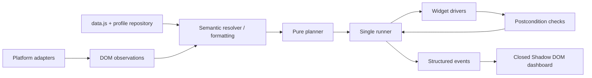

# Runtime architecture — v2

The unpacked extension loads directly from this directory. No bundler or runtime dependency is required. Each classic script owns an IIFE scope; manifest.json declares the dependency order. `scripts/build.cjs` regenerates UI styles and the public standalone client.

## Responsibilities

| Source | Responsibility |
| --- | --- |
| `data.js` | Original personal facts; no matching or executable platform rules |
| `core/field-catalog.js`, `profile.js` | Semantic keys, locale and type formatting, explicit stale-date handling, local profile overrides |
| `core/matching.js` | Shared exact/approved-alias matching with ambiguity detection; no first-option fallback |
| `adapters/` | Host detection and platform-specific semantic mappings |
| `core/dom.js`, `scanner.js` | Field hints, visibility, form grouping, locators, DOM observations |
| `core/planner.js` | Action descriptors without DOM mutations or consumed link counters |
| `core/runner.js` | Single promise, cancellation, action states, rescan boundaries, structured results |
| `drivers/` | Native fields, custom comboboxes, and on-demand uploads; no personal answers |
| `core/validation.js` | Actual selected values, required fields and files, bounded subform commit verification |
| `core/controller.js` | Session, API, dynamic form discovery, bounded replan loop, trusted/public channels |
| `core/dashboard.js`, `ui.css` | Plan review, exclusions, per-run answer edits, progress and explicit results |
| `core/learning.js`, `core/knowledge-store.js` | Semantic approved/observed mappings; serialized worker writes across frames; origin/form/path/type/accessible labels scope |
| `core/improvement.js` | Automatic bounded run evidence and development-only sanitized fixture collection |
| `core/dev-runtime.js` | Protected local development mode, revision polling/reconnect, guarded extension reload and URL-checked related-tab refresh |
| `core/diagnostics.js` | Opt-in structural fixtures with values and unrelated content removed |
| `background.js`, `core/background-worker.js` | Event-driven frame coordination and private attachment access |
| `options.*`, `core/attachment-store.js` | Profile overrides, approved-rule management, private PDF storage |
| `scripts/dev/server.cjs` | Authenticated loopback development I/O, separate from production execution |

`engine.js`, `ui.js`, `content.js` and `site-rules.js` are small compatibility/verification entries. They do not contain a second implementation. Historical Oracle research is preserved separately in `docs/oracle-history.md`.

## Trust and data flow

- Personal data and drivers run in `ISOLATED`. Only `page-bridge.js` runs in `MAIN`.
- The bridge exposes redacted metadata. Page messages cannot read the profile, retrieve PDFs, approve learned values, unlock submission or run arbitrary selectors/code with extension privileges.
- Page fill/play calls require a session activated by the popup or a trusted dashboard click, bound to the current URL. The page itself cannot prove it is an agent; origin/source checks are transport checks, not agent authentication.
- The trusted API remains available in the extension execution context. Final submit through the API needs an explicit per-call `confirmSubmit` or a deliberate trusted unlock; the fill pipeline never submits.
- The bundled PDF is a protected extension asset, absent from content-script lists and web-accessible resources. User-supplied PDFs are in extension-origin IndexedDB. Bytes are requested only for an upload action.
- The standalone file is a client for the same isolated engine and requires the installed extension. It embeds neither a profile nor a PDF.
- Normal mode stores run counters/gaps locally without values. Development polling/fixture upload starts only when npm run dev has created the protected ignored config; no arbitrary active-tab refresh is used. Dirty/busy forms defer the update.

## Execution invariants

1. At most one Engine promise and one fill orchestration run per document.
2. Cancellation aborts waits and cooperative drivers; no later queued action starts. An effect already dispatched cannot be rolled back.
3. Queue membership is distinct from verified completion. Failures do not increase `verifiedFields`.
4. Each action carries a target locator, original URL and form signature. Structural changes lead to a fresh plan rather than using stale references.
5. Expansions are verified before a fresh scan. Field actions precede subform commits. Failed commits are not automatically retried.
6. Existing values and selected radio groups are preserved. Explicit plan exclusions remain excluded in that run.
7. An unknown screening question is left for review; consent and subscription checkboxes are never guessed.
8. Attachment assignment uses the field label, not the first file input.

Results include `status`, `success`, `verifiedFields`, `attemptedActions`, `failedActions`, `blockedActions`, `cancelled`, individual action codes and unresolved fields. `total`/`filled` are retained as compatibility names. A completed action plan does not imply a real ATS backend has accepted an application.

## Verification

The unit suite imports the production matcher/profile; the HTTP handler is exercised in memory. The browser suite installs this actual extension with CDP in a disposable Chrome profile inside `test-suite/.profiles`, with all HTTP(S) traffic fulfilled from local fixtures or aborted. It tests MAIN/ISOLATED separation, dynamic forms, upload behavior, explicit submission, cross-origin frames, and worker restart. Disposable profiles are removed only after validating their location.

Live ATS frameworks, server-side upload processing, CAPTCHA/OTP and browser components requiring trusted native events still need site-specific verification. Synthetic events do not become trusted through `composed: true`.

The generic scanner now traverses open shadow roots, handles contenteditable/ARIA textbox fields, recognizes button comboboxes, and uses HTML autocomplete metadata for semantic/format resolution. The planner reuses one signature per form within a scan. Closed shadow roots remain outside standard DOM access. The current agent procedure has one authoritative source: `docs/agent-contract.md`; historical logs are evidence, not current instructions.
